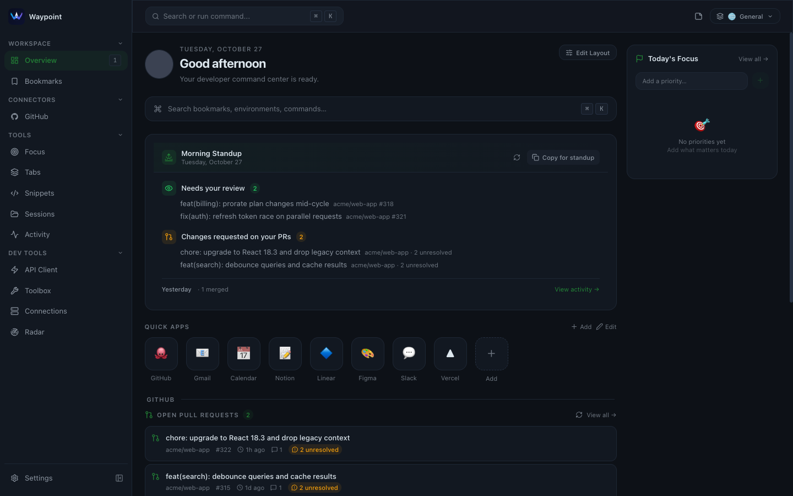
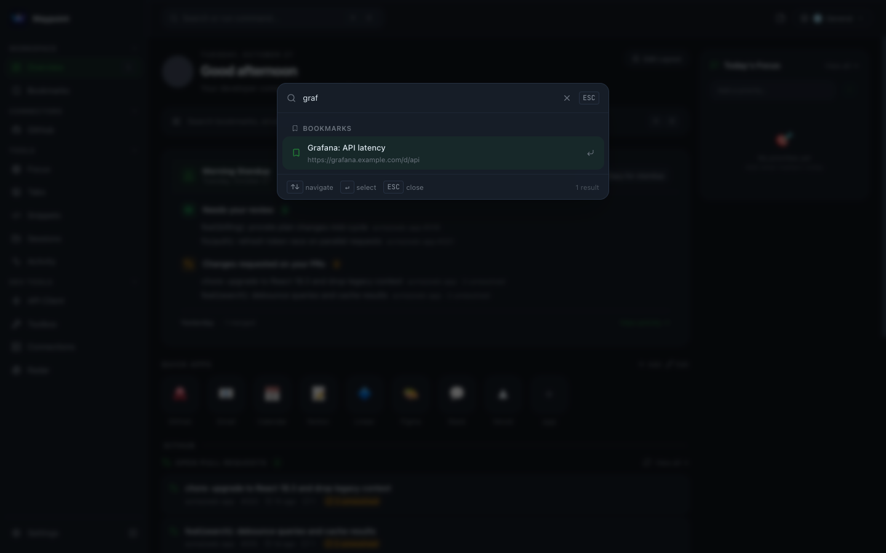
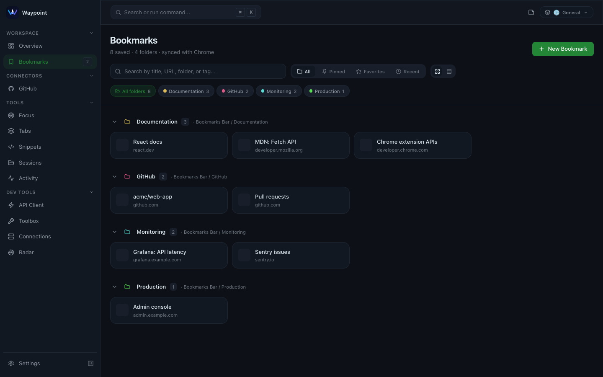
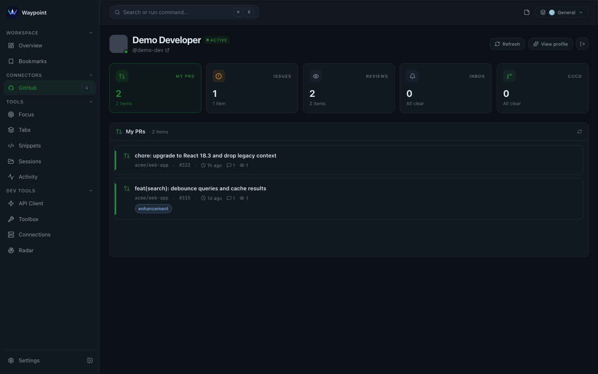
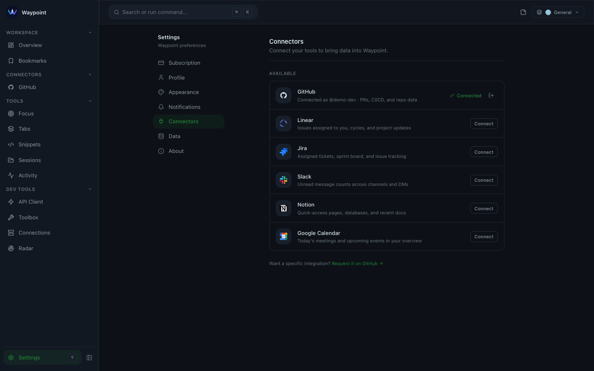
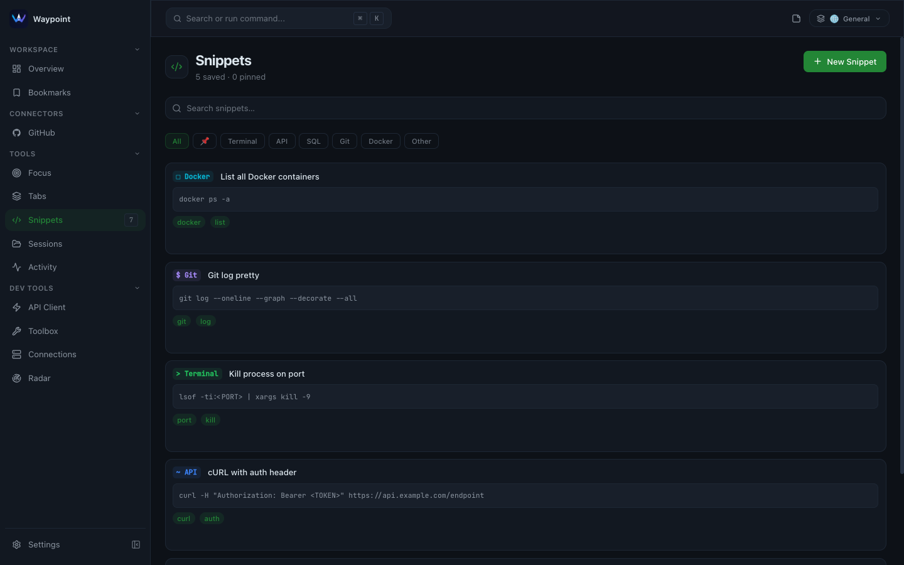
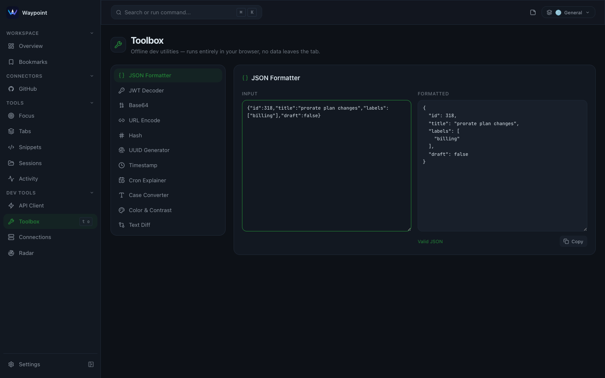
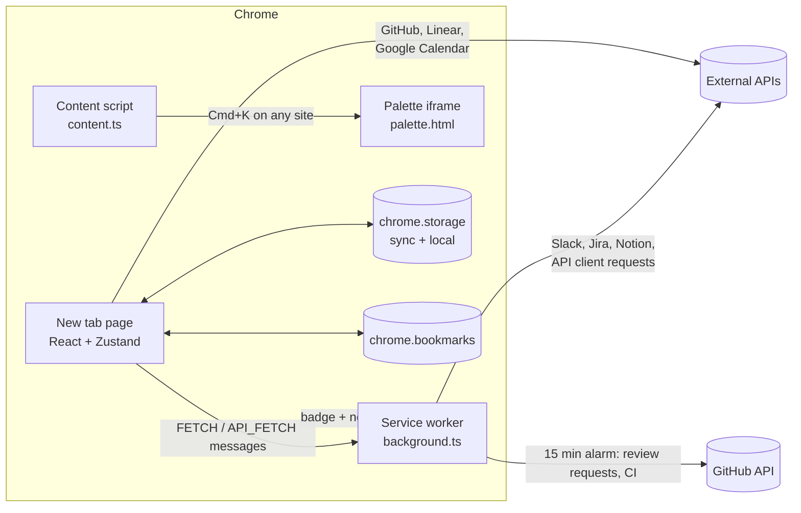

# Waypoint

**A new tab page for developers.** Waypoint replaces Chrome's new tab with a keyboard-driven workspace: the pull requests waiting on you, your bookmarks and environments, snippets, tab sessions and a set of offline dev tools, one `Cmd+K` away.

It is a Manifest V3 Chrome extension built with React, TypeScript and Vite. There is no backend. Data stays in `chrome.storage` on your machine, and integrations call GitHub, Linear, Jira, Slack, Notion and Google Calendar directly with credentials you provide.



<sub>Screenshots and the demo video use a fictional sample dataset (`acme/web-app`). GitHub responses are mocked; everything else is the real extension. See [Regenerating the media](#regenerating-the-screenshots-and-video).</sub>

**Demo video:** [docs/demo/waypoint-demo.webm](docs/demo/waypoint-demo.webm) (24 seconds: overview, command palette, bookmarks, GitHub, snippets, toolbox, API client and connectors).

## Why it exists

A developer's first tab of the day usually turns into five: GitHub to see which reviews are waiting, the issue tracker, a dashboard bookmark, the docs page you always need, and a terminal note with the command you can never remember. Waypoint puts those on the page Chrome already opens every time you press `Cmd+T`, and makes all of it reachable from the keyboard.

Because it is an extension rather than a web app, it can do things a hosted dashboard cannot: read and write your real Chrome bookmarks, see and group your open tabs, poll GitHub in the background and badge the toolbar icon, and make API calls that a normal page would be blocked from by CORS.

## What you can do with it

### Start the day from one page

The overview builds a stand-up digest from GitHub (reviews requested from you, changes requested on your PRs, what merged yesterday) with a one-click "copy for stand-up". Below it are quick-launch apps, open PRs and CI status, and widgets for Linear, Jira, Slack, Notion and Calendar once they are connected. The layout is configurable from **Edit Layout**.

### Find anything with `Cmd+K`

| Command palette                                                                      | Bookmarks                                                             |
| ------------------------------------------------------------------------------------ | --------------------------------------------------------------------- |
|  |  |

The palette fuzzy-searches (Fuse.js) bookmarks, snippets and commands, and navigates between sections. Single-key chords such as `g h` (GitHub) and `n o` (Notion) and `Cmd+1` to `Cmd+9` cover the rest.

Bookmarks are your real Chrome bookmarks, grouped by folder. Waypoint layers its own metadata on top (pin, favorite, tags, environment label) without changing the bookmark itself, so anything you add in Chrome shows up here and the other way round. Links labelled as production ask for confirmation before opening.

### Connect the tools you already use

| GitHub                                                                                          | Connectors                                                                |
| ----------------------------------------------------------------------------------------------- | ------------------------------------------------------------------------- |
|  |  |

- **GitHub** (personal access token): your PRs, assigned issues, review requests, notifications and Actions status for watched repos. A background alarm checks every 15 minutes, badges the toolbar icon with the number of reviews waiting, and sends a desktop notification for new ones.
- **Linear, Jira, Slack, Notion** (API tokens): assigned issues, unread counts and recent pages.
- **Google Calendar** through `chrome.identity` OAuth with a read-only scope.

A connector only appears in the sidebar once it is connected. Settings > Connectors lists all of them.

### Keep small tools close

| Snippets                                                   | Toolbox                                                                |
| ---------------------------------------------------------- | ---------------------------------------------------------------------- |
|  |  |

- **Snippets** with categories, pinning and `{{variables}}`. Selecting text on any page and choosing _Save to Waypoint Snippets_ from the context menu adds it here.
- **Toolbox** of offline utilities: JSON formatter, JWT decoder, Base64, URL encoding, hashing, UUIDs, timestamps, a cron explainer, case converter, colour contrast checker and text diff. Nothing leaves the page.
- **API client** with environments, `{{variable}}` interpolation and history. Requests go through the service worker, so they are not blocked by CORS.
- **Tabs and sessions:** see open tabs, find duplicates, act on tabs in bulk, and save or restore a window as a named session.
- **Focus** (daily priorities and notes), an **activity** log, **Radar** (status of common developer services from their Statuspage APIs, plus the latest versions of npm and PyPI packages you watch) and saved **connections** (SSH hosts and databases with copyable commands).

## How it is built



The extension has four entry points, all built by one Vite config:

| Entry                              | Role                                                                                        |
| ---------------------------------- | ------------------------------------------------------------------------------------------- |
| `index.html` / `src/main.tsx`      | The new tab page. Boots storage, hydrates the stores and routes between sections.           |
| `src/background.ts`                | Service worker: GitHub polling, badge and notifications, context menu, and the fetch proxy. |
| `src/content.ts`                   | Injects the command palette as an iframe when you press `Cmd/Ctrl+K` on a web page.         |
| `palette.html` / `src/palette.tsx` | The palette UI used inside that iframe.                                                     |

Decisions worth knowing about:

- **One storage layer, two Chrome areas.** `src/services/storage.ts` routes each key to `chrome.storage.sync` or `chrome.storage.local`. Small configuration (settings, layouts, snippets) syncs across your Chrome profiles; tokens, caches and large data stay local and are never synced. A sync write that exceeds Chrome's quota falls back to local instead of failing. Outside the extension (the Vite dev server) the same API is backed by `localStorage`.
- **Chrome bookmarks as the source of truth.** Waypoint used to keep its own bookmark list. It now reads the Chrome bookmark tree and stores only an overlay keyed by bookmark id. A one-time migration (`migrateEnvironmentsToBookmarks.ts`, unit tested) moved the old "environments" into real bookmarks.
- **A narrow fetch proxy.** Some APIs reject requests from an extension page because of CORS, so those calls are sent to the service worker as messages. Because the worker holds the extension's host permissions, it ignores any message that does not come from one of the extension's own pages, so a website cannot use it as an open proxy.
- **One Zustand store per domain** (`src/store/`), each responsible for loading and persisting its own keys. Components mostly subscribe through selectors, so a change in one area does not re-render unrelated sections.
- **Optional telemetry.** Sentry and PostHog are only initialised when their keys are present at build time. Session replay masks every form input, since the API client and snippets can contain tokens.

### Stack

| Area                  | Choice                                                                   |
| --------------------- | ------------------------------------------------------------------------ |
| UI                    | React 18, TypeScript (strict), Tailwind CSS, Framer Motion, Lucide icons |
| State                 | Zustand                                                                  |
| Drag and drop         | dnd-kit                                                                  |
| Search                | Fuse.js                                                                  |
| Build                 | Vite 6, four entry points                                                |
| Monitoring (optional) | Sentry, PostHog                                                          |
| Testing               | Vitest, Playwright                                                       |
| Tooling               | ESLint, Prettier, Husky and lint-staged, GitHub Actions                  |

### Project layout

```
src/
  main.tsx, App.tsx    New tab entry and section routing
  palette.tsx          Palette entry used by the content script iframe
  background.ts        Service worker
  content.ts           Cmd/Ctrl+K overlay on web pages
  features/<name>/     One folder per section (overview, bookmarks, github, toolbox, ...)
  store/               Zustand stores, one per domain
  services/            Storage layer, API clients, fetch proxy client, migrations
  components/ui/       Shared primitives (Button, Modal, Badge, ...)
  lib/                 Sentry and PostHog setup
e2e/                   Playwright suite against the built extension
scripts/capture/       Regenerates the README screenshots and demo video
public/manifest.json   Extension manifest (permissions, OAuth client, entry points)
```

## Getting started

Requirements: Node.js 22, npm and Google Chrome.

```bash
npm ci
npm run build
```

Open `chrome://extensions`, turn on **Developer mode**, choose **Load unpacked** and select the `dist/` folder. Open a new tab.

To work on the UI with hot reload:

```bash
npm run dev
```

This serves the new tab page at `http://localhost:6301`. Chrome-only APIs (bookmarks, tabs, identity, the service worker) are not available there: storage falls back to `localStorage` and the bookmarks panel stays empty. Load the built extension to test those.

### Configuration

All environment variables are optional; copy `.env.example` to `.env` to set them. When a value is empty, that integration is off.

| Name                | Purpose                                        |
| ------------------- | ---------------------------------------------- |
| `VITE_SENTRY_DSN`   | Sentry error reporting                         |
| `VITE_POSTHOG_KEY`  | PostHog analytics and session replay           |
| `VITE_POSTHOG_HOST` | PostHog ingest host (defaults to the US cloud) |

They are read at build time and end up in the bundle, which is normal for client-side keys, so never put server secrets there.

Google Calendar uses the OAuth client ID in `public/manifest.json` (`oauth2.client_id`). It only works for the extension ID it was created for; for your own build, create a "Chrome extension" OAuth client in Google Cloud and replace it.

### Scripts

| Command                           | What it does                                                                               |
| --------------------------------- | ------------------------------------------------------------------------------------------ |
| `npm run dev`                     | Vite dev server on port 6301                                                               |
| `npm run build`                   | Typecheck, then build the extension into `dist/`                                           |
| `npm run lint`                    | ESLint                                                                                     |
| `npm run typecheck`               | `tsc -b`                                                                                   |
| `npm run format` / `format:check` | Prettier on `src/` and `e2e/`                                                              |
| `npm test`                        | Vitest unit tests                                                                          |
| `npm run test:e2e`                | Playwright suite (run `npm run build` first; needs `npx playwright install chromium` once) |
| `npm run docs:media`              | Regenerate the README screenshots from `dist/`                                             |

## Testing and quality

- **Unit tests** (`src/**/*.test.ts`, 34 tests) cover the storage layer (sync/local routing, quota fallback, turning cloud sync on and off), the environments-to-bookmarks migration, the API client and the Radar pollers. They run in Node against a small in-memory fake of `chrome.storage`.
- **End-to-end tests** (`e2e/`, 127 tests) load the built extension into Chromium and mock every external API. They are tagged by priority, so `npm run test:e2e:p0` runs the critical paths.
- **CI** (`.github/workflows/ci.yml`) runs lint, the format check, typecheck, unit tests and the build on every push and pull request. The Playwright suite has its own workflow.

Current state, honestly: lint (no errors), format check, typecheck, unit tests and the build all pass. The end-to-end suite was written before a large UI redesign and is only partly updated. On the last full run, 99 of 127 passed. The connector specs (GitHub, Linear, Jira, Slack, Notion, Calendar) are green. Most of the 28 failures are in the bookmarks, environments and navigation specs, which still assume the old sidebar and the old bookmark storage. A few are in the command palette, snippets, onboarding, overview, error boundary and content script specs and have not been diagnosed yet.

## Permissions and privacy

| Permission                            | Used for                                                  |
| ------------------------------------- | --------------------------------------------------------- |
| `storage`                             | All user data                                             |
| `bookmarks`                           | The bookmarks section (reads and writes Chrome bookmarks) |
| `tabs`, `tabGroups`                   | Tab manager, sessions, duplicate detection                |
| `identity`                            | Google sign-in for Calendar                               |
| `alarms`, `notifications`             | Background polling for GitHub review requests and CI      |
| `contextMenus`                        | "Save to Waypoint Snippets" on selected text              |
| Content script on all `http(s)` pages | The `Cmd/Ctrl+K` palette overlay                          |

Data leaves your machine only as requests to the services you connect, through Chrome sync for the synced keys (if you are signed in to Chrome and cloud sync is on), and to Sentry or PostHog if you configured them at build time.

## Status and limitations

Waypoint is a working personal project. It is not published on the Chrome Web Store.

- **The Pro plan is a stub.** The upgrade screens and checkout links are placeholders, and license activation only checks a key prefix locally. There is no payment or license validation.
- **The palette content script runs on every site** and takes over `Cmd/Ctrl+K`, which some sites use themselves.
- **Desktop only.** The layout assumes a desktop-width window; below about 600px the sidebar crowds the content.
- **The end-to-end suite is partly out of date** (see above). Component behaviour is otherwise covered only by those Playwright tests.
- The main bundle is about 650 kB before gzip. It loads from disk, so this matters less than on the web, but the feature panels are not code-split yet.

## Regenerating the screenshots and video

`scripts/capture/capture.spec.ts` loads `dist/` into Chromium, creates sample Chrome bookmarks, mocks the GitHub API with fictional data and saves PNGs to `docs/screenshots/`:

```bash
npm run build
npm run docs:media
```

Set `VIDEO_DIR` to also record the walkthrough as WebM (Playwright's recorder). The committed video had its first two seconds (the page loading) trimmed with ffmpeg. To convert it to MP4:

```bash
ffmpeg -i docs/demo/waypoint-demo.webm -c:v libx264 -pix_fmt yuv420p -movflags +faststart waypoint-demo.mp4
```

## License

No license has been chosen yet, so all rights are reserved by the author. Get in touch before reusing the code.
